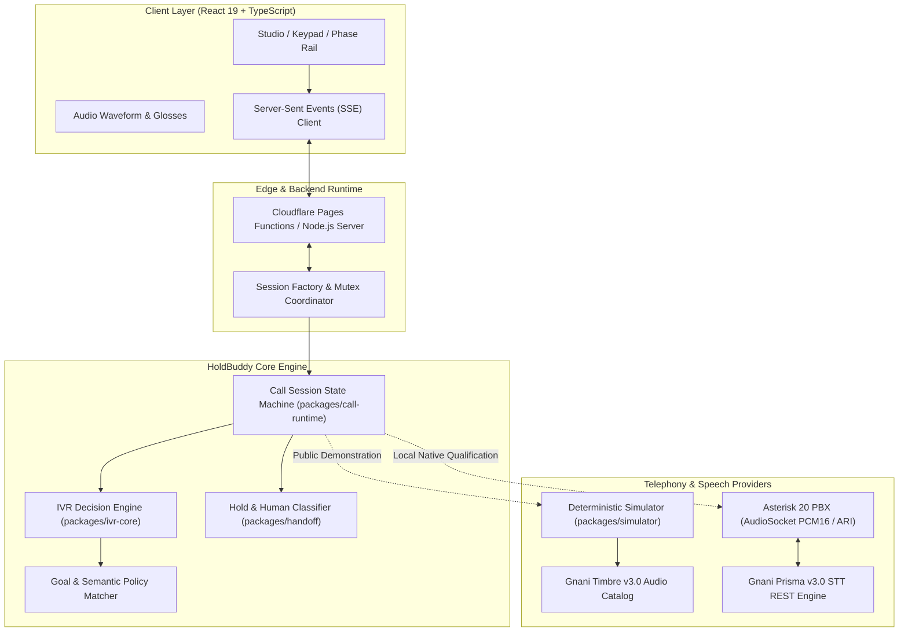

# HoldBuddy — Hold, handled.

> **An intelligent, sovereign voice AI agent that navigates complex Indian customer-care IVRs, waits on hold, and hands control back to you when a human agent answers.**
> 
> *Built for the **Gnani AI Great Indian AI Internship Challenge 2026**.*

[](https://github.com/AkshayAlgoX/HoldBuddy/actions)
[](./LICENSE)
[](https://nodejs.org/)
[](https://gnani.ai)
[](https://holdbuddy-cloudflare-pages.pages.dev/)

---

## 1. The Customer-Care Problem in India

Every day, millions of Indian consumers call telecom, banking, and utility customer helplines. The experience is notoriously frustrating:
- **Long, nested multi-level IVR menus** requiring constant attention and manual dialpad pressing across Hindi, English, and regional languages.
- **Ambiguous or unfamiliar phrasing** that leads to wrong departments or accidental disconnection.
- **Excruciating wait times on hold (15–45 minutes)** filled with repetitive hold music, preventing users from getting work done.
- **Missed human handoffs:** If the caller steps away for just 10 seconds and an executive picks up, the call is abruptly terminated due to silence.

**HoldBuddy solves this end-to-end:** you state your goal in plain Hindi or Hinglish, HoldBuddy takes over the line, listens to the prompts, makes intelligent DTMF navigation decisions, absorbs the entire hold period, and immediately alerts you the moment a live human representative speaks.

---

## 2. Product Experience & Interface

HoldBuddy features a clean, responsive client interface designed for both mobile handsets and desktop workstations.

```
┌────────────────────────────────────────────────────────────────────────┐
│  HoldBuddy — Studio                                    [ 00:48 / Live ]│
├────────────────────────────────────────────────────────────────────────┤
│                                                                        │
│   Goal: "मेरे ब्रॉडबैंड बिल की शिकायत" (Broadband Bill Complaint)      │
│                                                                        │
│   Phase Track:                                                         │
│   [● Menu 1: '5'] ───> [● Menu 2: '8'] ───> [● Menu 3: '1'] ───> [Hold]│
│                                                                        │
│   Live Transcript & Audio:                                             │
│   "कृपया लाइन पर बने रहें। हमारे सभी प्रतिनिधि व्यस्त हैं..."          │
│    ▂▃▅▇█▇▅▃▂  [Playing: Gnani Timbre v3.0 Shivani]                     │
│                                                                        │
│  ┌──────────────────────────────────────────────────────────────────┐  │
│  │ 🔔 POSSIBLE HUMAN AGENT DETECTED: "नमस्ते, मेरा नाम आशा है..."   │  │
│  │ [ Take Over Call ]                      [ Dismiss / Keep Waiting ]│  │
│  └──────────────────────────────────────────────────────────────────┘  │
│                                                                        │
└────────────────────────────────────────────────────────────────────────┘
```

- **Live Navigation Phase Rails:** Visual indicators tracking current menu depth and dispatched DTMF digits (`5 → 8 → 1`).
- **Real-Time Speech Waveforms:** Synchronized audio visualization with millisecond-accurate transcript glosses.
- **Human Arrival Alert:** Prominent audio and visual alert triggering immediately upon agent voice classification.
- **Developer Laboratory:** An inspection suite for reviewing state transitions, decision ledgers, and telemetry.

---

## 3. Live Demonstration & Video

- **Public Interactive Web Demo:** [https://holdbuddy-cloudflare-pages.pages.dev/](https://holdbuddy-cloudflare-pages.pages.dev/)  
  *(Durable zero-cost Cloudflare edge deployment with full mobile support).*
- **Secondary Web Demo:** [https://holdbuddy-demo-deploy.onrender.com/](https://holdbuddy-demo-deploy.onrender.com/)
- **60-Second Competition Video:** High-definition video walkthrough showcasing the complete Hindi customer journey from IVR dialing to human executive handoff.

---

## 4. Key Features & Supported Scenarios

| Scenario | Input Objective | Navigation Path | Decision Outcome |
|---|---|:---:|---|
| **Broadband Bill Complaint** | `"मेरे ब्रॉडबैंड बिल की शिकायत"` | `5 → 8 → 1` | Navigates 3 levels, enters hold queue, detects executive greeting (`"नमस्ते, मेरा नाम आशा है"`), alerts user. |
| **Broadband Bill Payment** | `"मेरे ब्रॉडबैंड बिल का भुगतान"` | `5 → 8 → 2` | Navigates broadband (`5`), billing (`8`), payment help (`2`), enters hold, completes handoff. |
| **Unsupported Refund Request** | `"मेरे ब्रॉडबैंड बिल का रिफंड"` | `5 → 8` | Safely abstains (`decision.abstained: action_mismatch`) at menu level 3 when refund is unoffered. **Never guesses.** |

---

## 5. System Architecture

HoldBuddy is designed with a strict clean-architecture separation between the conversational decision engine, the session state machine, and the telephony/audio layer:



---

## 6. Gnani AI Integration Architecture

HoldBuddy leverages **Gnani AI's sovereign Indic speech models** across two distinct operational pipelines:

### 1. Gnani Timbre v3.0 (Text-to-Speech)
- **Model:** Timbre v3.0 (Shivani — Hindi Neural Voice).
- **Application:** Generates lifelike IVR telephony prompts and human agent greetings with authentic Indian cadence, numeral pronunciation, and natural conversational prosody.
- **Deployment:** Pre-generated audio assets (`prompt-02.wav` through `prompt-07.wav`) served over CDN and streaming endpoints with strict metadata (`x-holdbuddy-audio-origin: public_synthetic`).

### 2. Gnani Prisma v3.0 (Speech-to-Text)
- **Model:** Prisma v3.0 (`hi-IN` / Hindi telephonic model).
- **Application:** Transcribes incoming phone menu audio captured during live Asterisk PBX sessions via REST integration (`https://api.vachana.ai/stt/v3`).
- **Telemetry Verification:** Each native API response provides a verified provider request ID (`providerRequestId`), language probability, and word timings.

---

## 7. Asterisk 20 PBX & AudioSocket Native Verification

For native telephony verification, HoldBuddy integrates with **Asterisk 20** using Asterisk REST Interface (ARI) and AudioSocket:

1. **Audio Capture:** AudioSocket streams raw 16-bit 8kHz/16kHz linear PCM audio over TCP between the Asterisk channel driver and HoldBuddy's user-space daemon.
2. **Menu Turn Recognition:** Audio is framed and sent to Gnani Prisma STT after silence boundary detection.
3. **DTMF Dispatch:** When the IVR decision policy chooses an option (e.g., digit `5`), HoldBuddy issues an ARI command:
   ```http
   POST /ari/channels/{channelId}/dtmf?dtmf=5
   ```
4. **Independent Audit Ledger:** DTMF acknowledgement events, audio detaches, and hangup signals are recorded in an immutable local transaction ledger.

---

## 8. Public Demonstration vs. Native Telephony Boundary

To ensure absolute public safety, zero hosting costs, and resilience against cold starts, HoldBuddy maintains an intentional architectural boundary:

| Feature / Capability | Public Web Demonstration (`pages.dev`) | Local Native Qualified Testbed |
|---|:---:|:---:|
| **Runtime Environment** | Cloudflare Pages + Edge Functions | Node.js + Local Asterisk 20 PBX |
| **Hosting Cost** | $0.00 / month (Cloudflare Free) | Local developer workstation |
| **Voice Audio Source** | Genuine Gnani Timbre v3.0 WAV assets | Live Asterisk AudioSocket stream |
| **STT Execution** | Pre-verified deterministic fixtures | Live Gnani Prisma v3.0 REST calls |
| **Phone Lines Used** | 0 (No PSTN / carrier connection) | Local loopback softphone extension |
| **API Credentials Exposed** | None (Zero keys in code/bundle) | Server-side volatile memory |
| **Native Telephony Routes** | Fail closed (`404` / `403` / `503`) | Enabled for same-origin loopback |

---

## 9. Installation & Local Development

### Prerequisites
- **Node.js:** `>= 22.16.0` (Recommended: Node 22 LTS)
- **npm:** `>= 10.0.0`
- **Git**

### Quick Start (Local Web Simulator)
```bash
# 1. Clone the repository
git clone https://github.com/AkshayAlgoX/HoldBuddy.git
cd HoldBuddy

# 2. Install dependencies
npm install

# 3. Verify type integrity
npm run typecheck

# 4. Build frontend and backend bundles
npm run build

# 5. Start the local server
npm start
```
Open **[http://127.0.0.1:10000](http://127.0.0.1:10000)** in your browser.

---

## 10. Environment Configuration

Copy the example configuration file:
```bash
cp .env.example .env
```

| Variable | Default | Purpose |
|---|---|---|
| `PORT` | `10000` | Port for the HTTP and SSE server |
| `HOST` | `127.0.0.1` | Bind address (loopback for security) |
| `PUBLIC_ORIGIN` | `http://127.0.0.1:10000` | Allowed origin for CORS & SSE |
| `TELEPHONY_MODE` | `offline_mock` | `offline_mock` (safe default) or `live_native` |
| `GNANI_API_KEY` | *(blank)* | Optional key for live Prisma native runs |

---

## 11. Reproducible Test Suite

HoldBuddy includes a comprehensive automated test suite utilizing Node.js's native test runner (`node:test`):

```bash
# Run all 48 automated regression, isolation, and security tests
npm test
```

### Test Coverage Highlights:
- **`tests/server.test.mjs`:** Verifies deterministic 5→8→1 navigation, session mutex, rate limits, audio PCM integrity, and traversal rejection.
- **`tests/shared-objectives.test.mjs`:** Validates 8-concurrent visitor pacing, session isolation, and goal mutation rejection.
- **`tests/website-integration.test.mjs`:** Confirms presentation evidence contracts, anti-fabrication guards, and strict header policies.
- **`tests/build-integrity.test.mjs`:** Validates build output hashes, bundle hygiene, and anti-replay guards.
- **`tests/native-adapter.test.mjs`:** Tests native telephony loopback authorization, phrase gating, and fail-closed security.

---

## 12. Security & Privacy Model

- **No Credential Leakage:** No API keys, passwords, or tokens are committed to Git or bundled into browser assets.
- **Strict Content Security Policy (CSP):**
  - `default-src 'self'`
  - `form-action 'none'` (disables unauthorized external data postback)
  - `frame-ancestors 'none'` (prevents iframe embedding / clickjacking)
- **Local Loopback Isolation:** Privileged native endpoints verify `127.0.0.1` / `localhost` origins and reject external host headers.
- **Zero PII:** No user audio or phone numbers are recorded or persisted.

---

## 13. Known Limitations

- **Simulated Carrier Line:** The public web demonstration is an interactive simulation using genuine Gnani Timbre audio and verified transcripts. It does not initiate actual PSTN carrier phone calls.
- **Single Active Session per IP (Simulator):** To prevent edge abuse, visitor sessions are rate-limited and bound to single concurrent call threads.
- **Pre-defined Scenario Breadth:** Current IVR decision trees focus on common telecommunications broadband workflows (complaint, billing, payment, and refund refusal). Expanding to banking and aviation requires additional scenario definitions.

---

## 14. Technical Roadmap

- [x] Multi-level Hindi IVR decision engine with safe abstention (`5 → 8 → 1` and `5 → 8 → 2`).
- [x] Acoustic hold-music and human speech classification model.
- [x] Zero-cost durable Cloudflare Pages deployment with SSE streaming.
- [ ] Direct SIP / WebRTC bridge for live in-browser softphone calling.
- [ ] Regional Indic language packs: Kannada, Tamil, Telugu, and Marathi IVR navigation.
- [ ] On-device Whisper / Kokoro quantization for local edge inference on mobile devices.
- [ ] Enterprise CRM and ticketing webhook integrations (Zendesk, Freshdesk).

---

## 15. Team Credits

HoldBuddy was conceptualized, built, and qualified by:

- **Akshaya R ([@AkshayAlgoX](https://github.com/AkshayAlgoX))** — Core System Architecture, IVR Decision Policy, Asterisk AudioSocket Pipelines, Cloudflare Edge Deployment, and Test Automation.
- **Nikhil** — Product Strategy, Telephony Scenario Research, UI/UX Design Direction, and Competition Video Storyboarding.

---

## 16. Gnani AI Acknowledgment

We gratefully acknowledge **Gnani Innovations Private Limited** for organizing the **Great Indian AI Internship Challenge 2026** and providing access to their state-of-the-art sovereign Indic speech models:
- **Gnani Prisma v3.0** — High-accuracy telephonic Speech-to-Text.
- **Gnani Timbre v3.0** — Natural Indic Text-to-Speech.
- **Gnani Evon v3.3** — Indic multilingual reasoning models.

---

## 17. License & Third-Party Notices

- **Source Code:** Original HoldBuddy source code is licensed under the [Apache License, Version 2.0](./LICENSE).
- **Gnani Timbre Audio Assets:** Audio files (`prompt-02.wav` through `prompt-07.wav`) are synthetic speech outputs of Gnani Timbre v3.0, used with authorized competition distribution rights. They are not covered under Apache 2.0.
- **Third-Party Notices:** See [THIRD_PARTY_NOTICES.md](./THIRD_PARTY_NOTICES.md) for full font, model, and dependency licenses.

---

## 18. Contributing

Contributions are welcome! Please review [CONTRIBUTING.md](./CONTRIBUTING.md) and [CODE_OF_CONDUCT.md](./CODE_OF_CONDUCT.md) before submitting pull requests.
