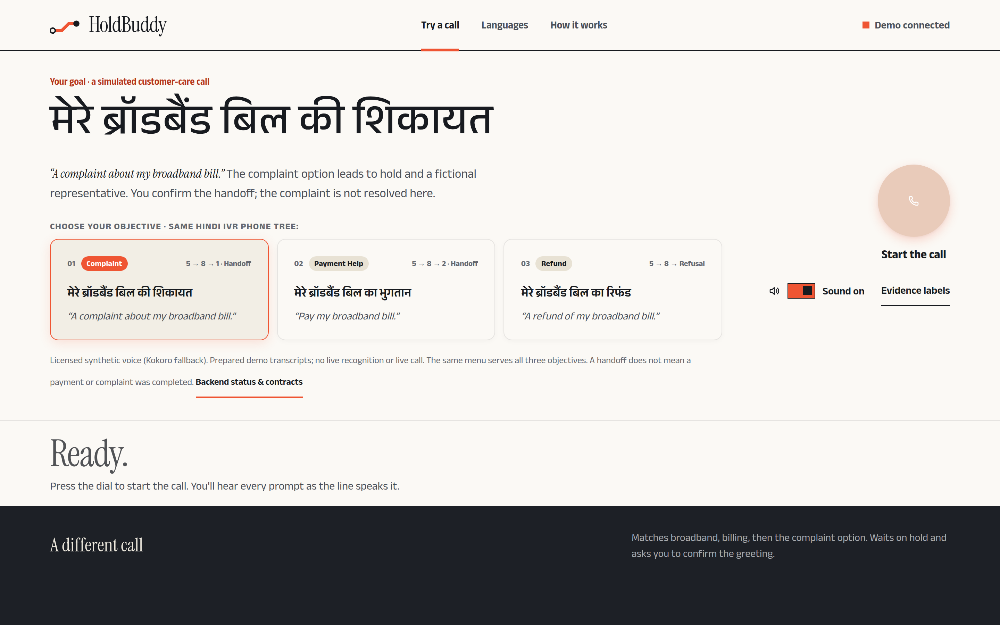
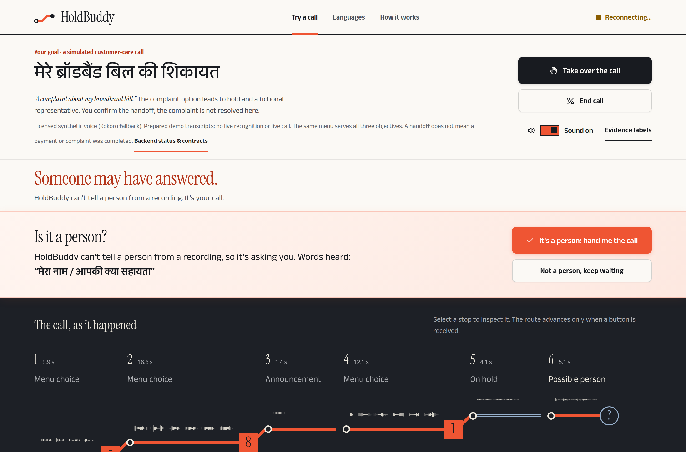
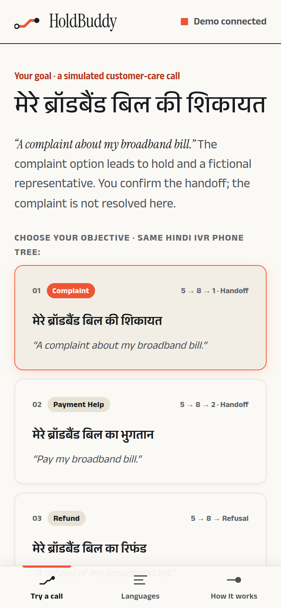
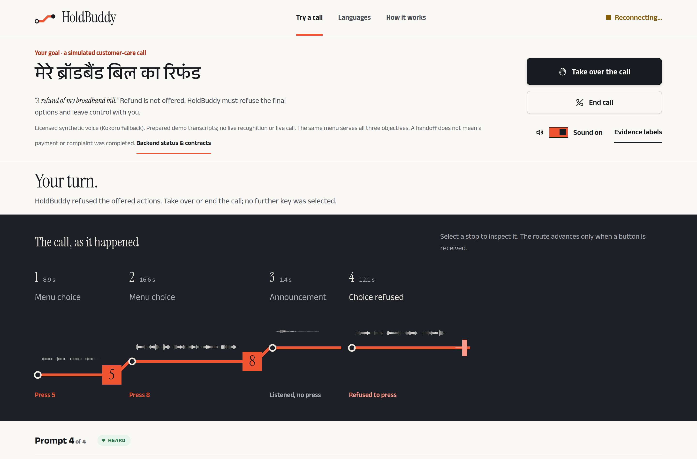
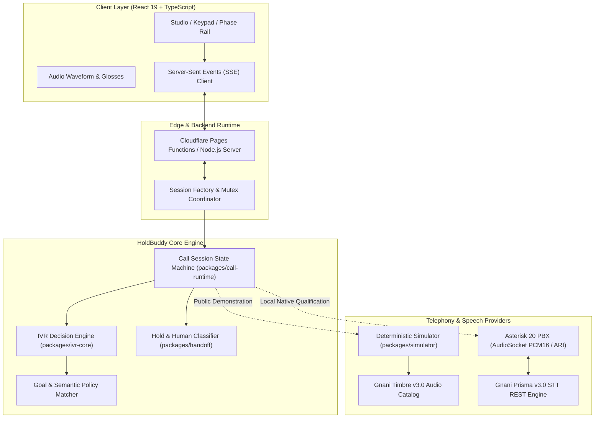

<div align="center">

# HoldBuddy — Hold, handled.

**A goal-driven voice AI prototype that explores navigating complex Indian customer-care IVRs, waiting on hold, and notifying you when a human agent answers.**

*Built for the **Gnani AI Great Indian AI Internship Challenge 2026**.*

[](https://github.com/AkshayAlgoX/holdbuddy/actions)
[](./LICENSE)
[](https://gnani.ai)
[](https://nodejs.org/)
[](https://holdbuddy-cloudflare-pages.pages.dev/)

---

### [🚀 Try the Live Interactive Demo on Cloudflare Pages](https://holdbuddy-cloudflare-pages.pages.dev/)
*Zero-install, mobile-ready Hindi IVR simulation running on Cloudflare Pages edge runtime.*

[**Live Demo**](https://holdbuddy-cloudflare-pages.pages.dev/) • [**Verified Evidence**](docs/GENUINE_NATIVE_EVIDENCE.md) • [**System Architecture**](#4-system-architecture--component-boundaries) • [**Local Reproduction**](#6-installation--reproducible-verification) • [**Known Limitations**](#7-known-limitations--truth-in-engineering)

---

</div>

<p align="center">
  
</p>

---

## 1. The Customer-Care Problem & The HoldBuddy Approach

### The Problem in India
Every day, millions of Indian consumers call telecom, banking, and utility customer helplines. The experience is notoriously frustrating:
- **Labyrinthine IVR Menus:** Deeply nested dialpad trees across Hindi, English, and regional languages that require callers to listen to repetitive, irrelevant options.
- **Cognitive Load & Ambiguity:** Dialpad options change or use unfamiliar phrasing, often leading to misrouting or accidental disconnection.
- **Prolonged Hold Queues:** Callers are stuck waiting through extended hold music, unable to step away or focus on other tasks.
- **Missed Representative Pickups:** If a customer representative finally answers while the caller is momentarily distracted, the call is easily dropped due to brief silence.

### The HoldBuddy Approach
HoldBuddy is designed as a focused Voice AI prototype for telephonic navigation:
1. **Goal-First Intent:** You specify your objective in Hindi or Hinglish (e.g., `"मेरे ब्रॉडबैंड बिल की शिकायत"`).
2. **Constrained DTMF Routing:** HoldBuddy listens to incoming telephonic prompts, performs goal-constrained semantic matching against transcribed menu options, and dispatches the corresponding DTMF tones (`5 → 8 → 1`).
3. **Hold-State Monitoring:** HoldBuddy monitors the call through the hold phase so the user does not have to remain glued to the handset.
4. **Human Arrival Notification:** Speech energy detection during the hold phase flags candidate representative greetings (`"नमस्ते, मेरा नाम आशा है..."`) and immediately prompts the caller to take over the call.
5. **Deterministic Safe Abstention:** If a requested intent (such as a refund) is absent from the menu options, HoldBuddy halts predictably (`action_mismatch`) rather than guessing an arbitrary keypress.

---

## 2. Product Experience & Visual Walkthrough

HoldBuddy features an editorial, high-clarity client interface designed for mobile touchscreens and desktop workstations.

### Live Call Progression & Human Executive Handoff
As the call advances through the Hindi IVR phone tree, HoldBuddy dynamically renders the live trajectory, monitors the hold queue, and prompts the user to take over the call when an executive greeting is detected:

<p align="center">
   8 -> 1 navigation, hold queue absorption, and human agent takeover prompt" width="100%">
</p>

### Mobile Responsiveness & Safe Refusal Policy

| Mobile Interface (390×844 Viewport) | Safe Refusal Policy (`5 → 8 → Abstain`) |
|:---:|:---:|
| [](docs/screenshots/mobile-layout-390.png) | [](docs/screenshots/desktop-refund-safe-refusal.png) |
| *Adaptive single-column layout optimized for mobile touchscreens* | *Deterministic refusal (`action_mismatch`): halts rather than guessing* |

### Supported Customer Scenarios

| Scenario | Input Objective | Navigation Path | Decision Outcome |
|---|---|:---:|---|
| **Broadband Bill Complaint** | `"मेरे ब्रॉडबैंड बिल की शिकायत"` | `5 → 8 → 1` | Navigates 3 menu levels, enters hold queue, detects executive greeting (`"नमस्ते, मेरा नाम आशा है"`), alerts user. |
| **Broadband Bill Payment** | `"मेरे ब्रॉडबैंड बिल का भुगतान"` | `5 → 8 → 2` | Navigates broadband (`5`), billing (`8`), payment help (`2`), enters hold, completes handoff. |
| **Unsupported Refund Request** | `"मेरे ब्रॉडबैंड बिल का रिफंड"` | `5 → 8` | Safely abstains (`decision.abstained: action_mismatch`) at menu level 3 when refund is unoffered. Deterministic safe refusal. |

---

## 3. Verified Native Engineering Evidence (Prisma STT + Asterisk 20)

Separately from the public zero-cost interactive web simulation, HoldBuddy completed an authorized end-to-end native engineering qualification driving a **real local Asterisk 20 PBX daemon** via ARI and AudioSocket with live **Gnani Prisma v3.0 Speech-to-Text REST requests** (`https://api.vachana.ai/stt/v3`):

### The 90-Second Evaluator Walkthrough
1. **Goal Selection:** User selects `"Complaint Help"` (`मेरे ब्रॉडबैंड बिल की शिकायत`) in the local developer console.
2. **Audio Injection:** Asterisk 20 PBX plays telecommunications Hindi IVR audio into the local channel driver.
3. **Live Gnani Prisma STT:** Prisma processes 3 live Hindi telephonic menus (sub-350ms server latency; Request IDs: `7113b10c-67ac-4e12-8636-4d2d24931413`, `77114a5f-ec02-4d5d-962a-60af1010356c`, `fa8604c5-7367-45a3-9038-ab8891d1b339`).
4. **Constrained Decision Controller:** HoldBuddy routes `5 → 8 → 1` (**3 out of 3 correct decisions** in this controlled journey).
5. **Independent Telephony Receipts:** Asterisk independently confirms DTMF keypresses (`5`, `8`, `1`) on the channel wire.
6. **Safe Detach & Teardown:** 119 ms clean media detach; Asterisk daemon exits cleanly with **code 0**.

### Verified 3-Turn Navigation Summary

In our controlled qualification run (`native-web-2da1e346-7689-4d2b-925f-96f3dd38566e`), HoldBuddy completed **3 out of 3 correct routing decisions** in this broadband complaint journey:

- **Turn 1 — Broadband Selection:**
  - **Prisma STT Request:** `7113b10c-67ac-4e12-8636-4d2d24931413` (204.9 ms server processing)
  - **Decision:** Pressed digit **`5`** (`broadband`)
  - **Asterisk Wire Receipt:** `ChannelDtmfReceived: 5` on channel `2e3842f4-98db-4d2b-a8b8-b9140501ee0a`
- **Turn 2 — Billing Category Selection:**
  - **Prisma STT Request:** `77114a5f-ec02-4d5d-962a-60af1010356c` (295.8 ms server processing)
  - **Decision:** Pressed digit **`8`** (`billing`)
  - **Asterisk Wire Receipt:** `ChannelDtmfReceived: 8` on channel `2e3842f4-98db-4d2b-a8b8-b9140501ee0a`
- **Turn 3 — Complaint Escalation:**
  - **Prisma STT Request:** `fa8604c5-7367-45a3-9038-ab8891d1b339` (266.6 ms server processing)
  - **Decision:** Pressed digit **`1`** (`complaint_help`)
  - **Asterisk Wire Receipt:** `ChannelDtmfReceived: 1` on channel `2e3842f4-98db-4d2b-a8b8-b9140501ee0a`

| Turn | Target Intent | Dispatched Digit | Prisma Request ID | Server Latency | Asterisk ARI Wire Confirmation |
|:---:|---|:---:|:---:|:---:|:---:|
| **1** | Broadband (`5`) | **`5`** | `7113b10c...1413` | 204.9 ms | `ChannelDtmfReceived: 5` (100ms) |
| **2** | Billing (`8`) | **`8`** | `77114a5f...356c` | 295.8 ms | `ChannelDtmfReceived: 8` (100ms) |
| **3** | Complaint (`1`) | **`1`** | `fa8604c5...b339` | 266.6 ms | `ChannelDtmfReceived: 1` (100ms) |

> 📖 **Full Engineering Report & Audio Artifacts:** Complete byte counts, full Hindi transcripts, PCM sample integrity verification, and Asterisk lifecycle logs are documented in [`docs/GENUINE_NATIVE_EVIDENCE.md`](docs/GENUINE_NATIVE_EVIDENCE.md). Machine-readable evidence: [`docs/evidence/genuine-acceptance-evidence.json`](docs/evidence/genuine-acceptance-evidence.json).

---

## 4. System Architecture & Component Boundaries

HoldBuddy enforces a strict architectural boundary between client presentation, conversational decision logic, and telephony hardware/speech adapters:



### Architectural Truth Matrix

To ensure absolute transparency, the implementation boundaries are classified below:

| Domain | Provenance | Implementation Details |
|---|---|---|
| **Speech Recognition** | **`REAL_API`** | Live HTTPS requests to **Gnani Prisma v3.0 REST STT** (`/stt/v3`). Returned real provider request IDs, detected Hindi language (`hi-IN`), and sub-350ms processing latencies. |
| **Telephony Control** | **`REAL_LOCAL_PBX`** | Native **Asterisk 20 PBX** on Linux loopback via ARI REST and AudioSocket TCP. DTMF injection with independent wire receipts (`ChannelDtmfReceived`). |
| **Carrier Trunking** | **`NONE`** | **No public PSTN trunking or live phone carrier connection.** Audio was routed through Asterisk loopback channels. We do not claim live carrier dialing. |
| **Local IVR Prompts** | **`CONTROLLED_SYNTHETIC`** | Hindi prompt WAVs played into Asterisk channels were pre-generated telecommunications benchmark fixtures with byte-exact PCM matching. |
| **Public Website Audio** | **`PREPARED_GNANI_TIMBRE`** | Public interactive web demonstration streams authentic pre-rendered **Gnani Timbre v3.0 Shivani** neural voice recordings (`prompt-02.wav` through `prompt-07.wav`). |
| **Public Web Demo** | **`EDGE_SIMULATION`** | Cloudflare Pages consumer site simulates the timeline on the edge for zero hosting cost; it does not connect to Asterisk or submit live API requests. |

---

## 5. Gnani AI Integration Architecture

HoldBuddy integrates **Gnani AI's sovereign Indic speech models** across two specialized pipelines:

### 1. Gnani Timbre v3.0 (Text-to-Speech)
- **Model:** Timbre v3.0 (Shivani — Hindi Neural Voice).
- **Role:** Delivers lifelike IVR telephony prompts and human agent greetings with authentic Indian cadence, numeral pronunciation, and natural conversational prosody.
- **Asset Delivery:** Served over Cloudflare CDN and streaming endpoints with strict metadata (`x-holdbuddy-audio-origin: public_synthetic`).

### 2. Gnani Prisma v3.0 (Speech-to-Text)
- **Model:** Prisma v3.0 (`hi-IN` / Hindi telephonic model).
- **Role:** Transcribes incoming phone menu audio captured during live Asterisk PBX sessions via REST integration (`https://api.vachana.ai/stt/v3`).
- **Telemetry Verification:** Each native API response provides a verified provider request ID (`providerRequestId`), language probability, and word timings.

---

## 6. Installation & Reproducible Verification

### Quick Start (Local Web Simulator)
```bash
# 1. Clone the repository
git clone https://github.com/AkshayAlgoX/holdbuddy.git
cd holdbuddy

# 2. Install dependencies
npm install

# 3. Verify type integrity
npm run typecheck

# 4. Build frontend and backend bundles
npm run build

# 5. Start the local server
npm start
```
Open **[http://127.0.0.1:10000](http://127.0.0.1:10000)** in your browser.

### Reproducing the Automated Test Suite
HoldBuddy includes 48 automated regression, isolation, and security tests using Node.js's native test runner (`node:test`):

```bash
# Run all 48 automated tests (clean offline execution)
npm test
```

### Reproducing the Offline Evidence Verification
Evaluators can verify the structural, sequence, and cryptographic invariants of the published evidence ledger in under 1 second using the included offline verifier:

```bash
# Run the structural, sequence, and cryptographic invariant verifier
npm run verify:evidence
```

Alternatively, run the script directly:
```bash
node scripts/verify-evidence.mjs
```

> [!NOTE]
> **Scope of Offline Verification:** This offline script validates internal schema invariants, sequential turn ordering (`1 → 2 → 3`), expected DTMF digits (`5 → 8 → 1`), valid 64-character SHA-256 prompt hex digests, and independent Asterisk ARI wire receipts. However, a self-contained JSON file cannot independently prove to a third party that Gnani's external servers emitted those responses without access to Gnani's server-side request audit logs. No external third-party certification is claimed.

---

## 7. Known Limitations & Truth in Engineering

To maintain scientific integrity and prevent exaggerated claims, the project scope is explicitly bound:

1. **No PSTN Carrier Calling:** The public web demonstration is an interactive simulation; the native testbed uses local Asterisk loopback. Neither initiates actual PSTN or cellular carrier phone calls.
2. **Controlled Journey Scope:** The native engineering test validated **3 out of 3 correct routing decisions in one specific controlled broadband complaint journey**. It does *not* claim universal 100% routing accuracy across untested telephony topologies.
3. **Latency Attribution:** The measured sub-350ms timings represent **Gnani Prisma v3.0 STT server processing times**, not the full round-trip latency of the complete decision pipeline.
4. **Constrained Goal Matcher:** HoldBuddy's controller is a **deterministic, goal-constrained semantic policy matcher** operating against discrete IVR menu choices; it is not an unconstrained, generative reasoning LLM.
5. **Internal Auditing Attestation:** Testing was verified internally by our automated engineering suite; no external third-party auditing agency is claimed.
6. **Single Active Session per IP (Demo):** To prevent edge abuse, visitor sessions are rate-limited and bound to single concurrent call threads.

---

## 8. Team Credits & Attribution

HoldBuddy was conceptualized, built, and qualified by:

- **Akshaya R ([@AkshayAlgoX](https://github.com/AkshayAlgoX))** — Core System Architecture, IVR Decision Policy, Asterisk AudioSocket Pipelines, Cloudflare Edge Deployment, and Test Automation.
- **Nikhil VS ([@Nikhil-VS1811](https://github.com/Nikhil-VS1811))** — Product Strategy, Telephony Scenario Research, UI/UX Design Direction, and Competition Video Storyboarding.

### Gnani AI Acknowledgment
We gratefully acknowledge **Gnani Innovations Private Limited** for organizing the **Great Indian AI Internship Challenge 2026** and providing access to their sovereign Indic speech models:
- **Gnani Prisma v3.0** — High-accuracy telephonic Speech-to-Text.
- **Gnani Timbre v3.0** — Natural Indic Text-to-Speech.
- **Gnani Evon v3.3** — Multilingual Indic reasoning models.

---

## 9. License & Third-Party Notices

- **Source Code:** Original HoldBuddy source code is licensed under the [Apache License, Version 2.0](./LICENSE).
- **Gnani Timbre Audio Assets:** Audio files (`prompt-02.wav` through `prompt-07.wav`) are synthetic speech outputs of Gnani Timbre v3.0, used with authorized competition distribution rights. They are not covered under Apache 2.0.
- **Third-Party Notices:** See [THIRD_PARTY_NOTICES.md](./THIRD_PARTY_NOTICES.md) for full font, model, and dependency licenses.
- **Contributing:** See [CONTRIBUTING.md](./CONTRIBUTING.md) and [CODE_OF_CONDUCT.md](./CODE_OF_CONDUCT.md).
